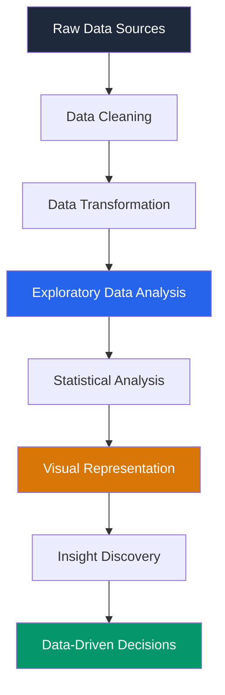

<div align="center">

# 📊 DATA VISUALISATION

### Transforming Complexity into Clarity


</div>

---

## 🌌 About the Repository

Data Visualisation is a collection of analytical experiments
focused on transforming raw and complex datasets into
meaningful visual representations.

The repository explores the intersection of statistical
analysis, visual intelligence, exploratory data analysis
and business intelligence.

Its objective is to uncover hidden patterns, identify trends,
communicate insights and enable informed decision-making
through effective data storytelling.

---

## 🚀 Core Focus Areas

| Domain | Description |
|--------|-------------|
| Exploratory Data Analysis | Understanding dataset characteristics |
| Statistical Analysis | Identifying distributions and relationships |
| Data Transformation | Preparing data for analytical workflows |
| Visual Analytics | Representing complex information visually |
| Business Intelligence | Developing decision-oriented insights |
| Dashboard Development | Monitoring metrics and performance |
| Data Storytelling | Communicating insights effectively |

---

## 🔄 Data Analytics Workflow



---

## 📈 Visualisation Techniques

| Visualisation | Purpose |
|---------------|---------|
| Bar Chart | Categorical comparison |
| Line Chart | Trend and time-series analysis |
| Pie Chart | Proportional distribution |
| Histogram | Frequency distribution |
| Scatter Plot | Relationship analysis |
| Box Plot | Outlier and distribution analysis |
| Heatmap | Correlation and intensity analysis |
| Pair Plot | Multivariate relationships |
| Interactive Dashboard | Business performance monitoring |

---

## 🧠 Analytical Capabilities

- Univariate, bivariate and multivariate analysis
- Correlation and covariance analysis
- Distribution and frequency analysis
- Outlier identification
- Trend and pattern recognition
- Statistical visualisation
- Key Performance Indicator analysis
- Interactive reporting and dashboards

---

## 🌍 Industry Applications

Visual analytics plays a critical role in modern
data-driven organisations.

| Organisation | Visual Analytics Application |
|--------------|------------------------------|
| Netflix | Audience engagement and content performance analytics |
| Google | Search trends and user behaviour analytics |
| NVIDIA | GPU performance and AI infrastructure monitoring |
| Amazon | Sales, inventory and supply chain analytics |
| Microsoft | Enterprise business intelligence through Power BI |
| Uber | Geographic demand and mobility analytics |
| Spotify | Listener engagement and streaming analytics |

These examples demonstrate real-world applications of
related visual analytics concepts.

---

## 🛠️ Technology Stack

| Technology | Application |
|------------|-------------|
| Python | Analytical programming |
| Pandas | Data manipulation |
| NumPy | Numerical analysis |
| Matplotlib | Custom visualisations |
| Seaborn | Statistical graphics |
| Power BI | Interactive business dashboards |
| Jupyter Notebook | Interactive data exploration |

---

## 💻 Getting Started

### Clone the repository

```bash
git clone https://github.com/Clestialcosmos/Data_Visualisation.git

cd Data_Visualisation
```

### Install dependencies

```bash
pip install numpy pandas matplotlib seaborn jupyter
```

### Launch Jupyter Notebook

```bash
jupyter notebook
```

---

## 🎯 Project Objectives

- Transform raw datasets into meaningful information.
- Discover hidden patterns and relationships.
- Develop effective statistical visualisations.
- Understand analytical and business intelligence workflows.
- Communicate complex information through data storytelling.
- Enable informed and data-driven decision-making.

---

## 💡 Why Data Visualisation Matters

Data alone does not create value.

Value emerges when data is transformed into information,
information into knowledge, and knowledge into decisions.

Effective visualisation enables organisations to understand
complexity, identify opportunities and make better decisions.

---

## 👨‍💻 Developer

<div align="center">

### Tanishq Tomar

Data Science | Visual Analytics | Artificial Intelligence

[](https://github.com/Clestialcosmos)

</div>

---

<div align="center">

### ⚡ Every Dataset Has a Story. Visualisation Reveals It.

⭐ Star this repository if you find it useful.

</div>
