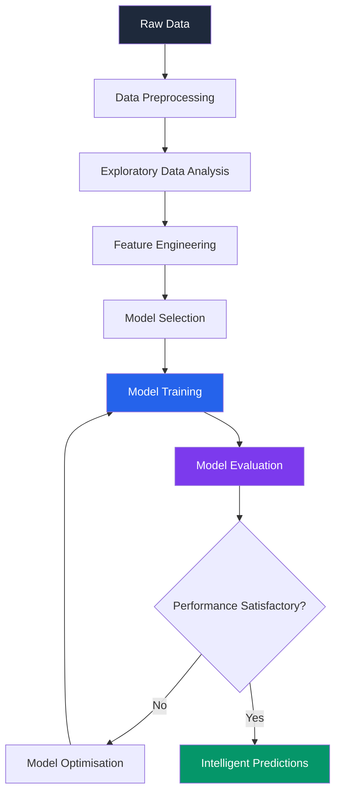

<div align="center">

# 🧠 MACHINE LEARNING 1.0

### Engineering Intelligence Through Data


</div>

---

## 🌌 About the Repository

Machine Learning 1.0 is a practical exploration of machine
intelligence, statistical learning and predictive analytics.

This repository focuses on understanding how computational
systems learn from data, identify hidden patterns, generalise
knowledge and generate intelligent predictions.

It bridges mathematical foundations with practical
implementations of modern Machine Learning techniques,
building the foundation for scalable, data-driven AI systems.

---

## 🚀 Core Focus Areas

| Domain | Description |
|--------|-------------|
| Data Engineering | Cleaning, transforming and preparing raw data |
| Feature Engineering | Extracting meaningful information from data |
| Supervised Learning | Learning from labelled datasets |
| Unsupervised Learning | Discovering hidden patterns and structures |
| Predictive Modelling | Generating data-driven predictions |
| Model Evaluation | Measuring accuracy and generalisation |
| Optimisation | Improving model performance and efficiency |

---

## ⚙️ Machine Learning Pipeline



---

## 🧩 Machine Learning Concepts

### Supervised Learning

- Linear Regression
- Logistic Regression
- Decision Trees
- K-Nearest Neighbours
- Support Vector Machines
- Ensemble Learning

### Unsupervised Learning

- K-Means Clustering
- Hierarchical Clustering
- Principal Component Analysis
- Pattern Recognition

### Model Evaluation

- Accuracy
- Precision and Recall
- F1 Score
- Confusion Matrix
- Mean Squared Error
- R-Squared Score
- Cross-Validation

---

## 🌍 Industry Applications

The Machine Learning concepts explored in this repository
are foundational to technologies used by global organisations.

| Organisation | Machine Learning Application |
|--------------|------------------------------|
| Netflix | Personalised recommendations and content discovery |
| Google | Search ranking and intelligent information retrieval |
| NVIDIA | AI computing, computer vision and autonomous systems |
| Amazon | Product recommendations and demand forecasting |
| Microsoft | Intelligent automation and predictive analytics |
| Spotify | Personalised music discovery and recommendations |
| Tesla | Computer vision and autonomous driving systems |

These are industry applications of related ML concepts,
not direct implementations of proprietary company systems.

---

## 🛠️ Technology Stack

| Technology | Application |
|------------|-------------|
| Python | Algorithm implementation |
| NumPy | Mathematical computation |
| Pandas | Data processing |
| Scikit-learn | Machine Learning |
| Matplotlib | Model and data visualisation |
| Seaborn | Statistical analysis |
| Jupyter Notebook | Interactive experimentation |

---

## 💻 Getting Started

### Clone the repository

```bash
git clone https://github.com/Clestialcosmos/Machine-learning1.0.git

cd Machine-learning1.0
```

### Install dependencies

```bash
pip install numpy pandas matplotlib seaborn scikit-learn jupyter
```

### Launch Jupyter Notebook

```bash
jupyter notebook
```

---

## 🎯 Project Objectives

- Understand the mathematical foundations of Machine Learning.
- Develop practical knowledge of predictive algorithms.
- Build structured Machine Learning pipelines.
- Evaluate model performance and generalisation.
- Explore real-world applications of Artificial Intelligence.
- Establish a foundation for advanced AI and Deep Learning.

---

## 👨‍💻 Developer

<div align="center">

### Tanishq Tomar

Data Science | Machine Learning | Artificial Intelligence

[](https://github.com/Clestialcosmos)

</div>

---

<div align="center">

### ⚡ Data is the foundation. Intelligence is the outcome.

⭐ Star this repository if you find it useful.

</div>
