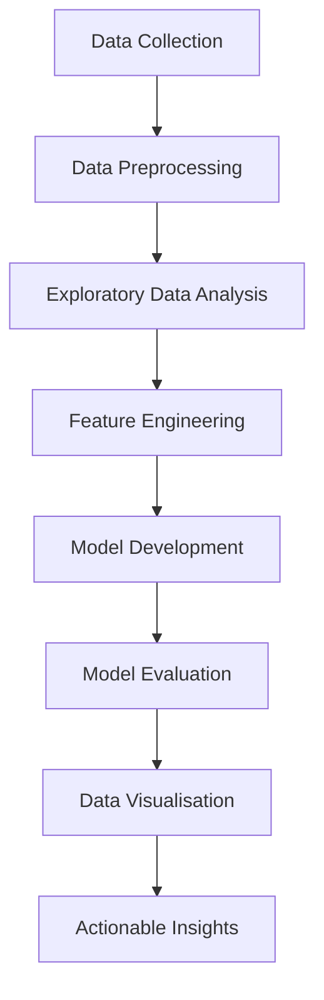

# Machine Learning & Data Visualisation Lab


## Student Information

| Particular | Details |
|------------|---------|
| Name | Tanishq Tomar |
| Enrollment Number | 22515500090 |
| Subjects | Machine Learning & Data Visualisation |
| Repository Type | Academic Lab Experiments |

## Overview

This repository serves as a consolidated collection of Machine
Learning and Data Visualisation laboratory experiments, focusing
on the practical implementation of statistical methods, predictive
modelling, data preprocessing, exploratory data analysis and
visual analytics.

The primary objective is to bridge the gap between theoretical
concepts and real-world data science applications through
hands-on experimentation and computational analysis.

## Repository Structure

```
Tanishq_Tomar_22515500090/
│
├── Machine-learning1.0/
│   └── Machine Learning Lab Experiments
│
├── Data_Visualisation/
│   └── Data Visualisation Lab Experiments
│
└── README.md
```

## Machine Learning

The Machine Learning module focuses on developing an
understanding of intelligent systems capable of identifying
patterns, learning from data and generating predictions.

### Learning Objectives

- Data preprocessing and feature engineering
- Supervised and unsupervised learning
- Regression and classification techniques
- Clustering and dimensionality reduction
- Model training, testing and evaluation
- Performance optimisation
- Statistical and mathematical analysis

[Explore Machine Learning Experiments](./Machine-learning1.0)

## Data Visualisation

The Data Visualisation module focuses on transforming complex
datasets into meaningful, interpretable and actionable insights
through effective visual representations.

### Learning Objectives

- Exploratory Data Analysis (EDA)
- Data cleaning and transformation
- Statistical visualisation
- Univariate and multivariate analysis
- Correlation and distribution analysis
- Interactive dashboards
- Data storytelling and business intelligence

[Explore Data Visualisation Experiments](./Data_Visualisation)

## Technology Stack

| Technology | Purpose |
|------------|---------|
| Python | Programming and implementation |
| NumPy | Numerical computation |
| Pandas | Data manipulation and analysis |
| Matplotlib | Statistical visualisation |
| Seaborn | Advanced data visualisation |
| Scikit-learn | Machine Learning algorithms |
| Jupyter Notebook | Interactive experimentation |
| Power BI | Business intelligence and dashboards |
| Git & GitHub | Version control and collaboration |

## Data Science Workflow



## Getting Started

### Clone the Repository

```bash
git clone https://github.com/Clestialcosmos/Tanishq_Tomar_22515500090.git

cd Tanishq_Tomar_22515500090
```

### Install Python Dependencies

```bash
pip install numpy pandas matplotlib seaborn scikit-learn jupyter
```

### Launch Jupyter Notebook

```bash
jupyter notebook
```

Navigate to the respective subject folder and open the
required experiment.

## Industry Applications

The concepts explored in this repository form the foundation
of modern data-driven systems used across industries:

- **Recommendation Systems:** Personalised content and product
  recommendations.
- **Predictive Analytics:** Demand forecasting and business
  performance prediction.
- **Fraud Detection:** Identifying unusual patterns and
  suspicious transactions.
- **Business Intelligence:** Interactive dashboards and
  strategic decision-making.
- **Healthcare Analytics:** Data-driven clinical insights.
- **Artificial Intelligence:** Intelligent automation and
  predictive modelling.

## Expected Learning Outcomes

- Develop proficiency in Machine Learning algorithms.
- Understand end-to-end data science workflows.
- Implement statistical and predictive models.
- Evaluate and interpret model performance.
- Communicate complex information through visual analytics.
- Apply theoretical concepts to real-world problems.

## Author

**Tanishq Tomar**

Enrollment Number: 22515500090

GitHub: [Clestialcosmos](https://github.com/Clestialcosmos)

## Acknowledgement

This repository has been developed for academic learning,
practical experimentation and strengthening technical
proficiency in Machine Learning and Data Visualisation.

---

**Transforming Data into Intelligence and Intelligence into Insights.**
